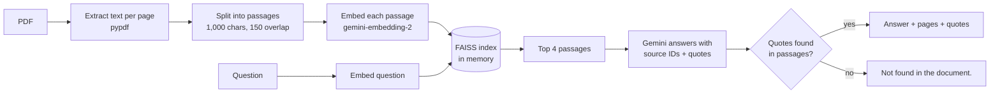

# Pagewise — Chat with your PDF, with page citations

Upload a PDF, ask a question, and get a short answer **with verified quotes and the page numbers they came from**. If the document doesn't contain the answer, Pagewise says so instead of guessing.

**Live demo:** https://chat-from-pdf.streamlit.app/ (no sign-up or API key needed)

**Stack:** Python · Streamlit · LangChain · FAISS · pypdf · Google Gemini API

---

## Contents

- [Features](#features)
- [Try the live demo](#try-the-live-demo)
- [How it works](#how-it-works)
- [Measured results](#measured-results)
- [Run it on your computer](#run-it-on-your-computer)
- [Deploy your own copy](#deploy-your-own-copy)
- [Gemini API limits (free tier)](#gemini-api-limits-free-tier)
- [Run the tests](#run-the-tests)
- [Run the evaluation](#run-the-evaluation)
- [Project structure](#project-structure)
- [Limitations](#limitations)
- [Roadmap](#roadmap)

---

## Features

- **Answers with proof** — every answer shows the source page and the exact quote it is based on.
- **Refuses instead of guessing** — answers whose quotes can't be found word-for-word in the PDF are rejected and shown as "Not found in the document."
- **Page-accurate citations** — text is split per page, so every passage maps to exactly one page.
- **Works without a key** — the hosted demo uses a built-in key with fair-use limits; visitors can add their own key to go past them.
- **Handles API limits gracefully** — waits and continues when Gemini's per-minute limit is hit, and retries temporary server errors once.
- **Measured, not guessed** — an evaluation script reports retrieval and answer accuracy on a labelled question set.
- **Offline test suite** — 52 tests that need no API key.

## Try the live demo

1. Open https://chat-from-pdf.streamlit.app/
2. In the sidebar, switch on **Try the sample handbook** (or upload your own PDF).
3. Click **Prepare PDF**.
4. Ask a question, for example:
   - "How many days of paid annual leave do employees receive?" → 20 days (page 1)
   - "How do I report a lost laptop?" → contact the IT help desk immediately (page 2)
   - "Who won the football World Cup?" → Not found in the document.
5. Open **Source** under an answer to see the quote and the passage it came from.

**Demo limits** (they keep the shared free quota available for everyone): 3 PDFs and 25 questions per visit, up to 150 passages per PDF (about 40–60 pages of notes). Need more? Open **Use your own API key instead** in the sidebar.

> **Privacy:** PDF text and questions are sent to Google's Gemini API. Free-tier content may be used by Google to improve its products, so please don't upload private or confidential documents.

## How it works



1. **Extract** — pypdf reads the text of each page and remembers the page number.
2. **Chunk** — each page is split into ~1,000-character passages with 150 characters of overlap. Passages never cross a page boundary, so each citation points to exactly one page.
3. **Embed** — each passage becomes a 768-number vector using Gemini embeddings.
4. **Retrieve** — FAISS finds the 4 passages most similar to the question (cosine similarity).
5. **Answer** — Gemini (`gemini-3.5-flash-lite`) returns structured JSON: an answer plus the passage IDs and exact quotes that support it.
6. **Verify** — the app checks that each cited passage exists and each quote appears word-for-word in it. If not, the answer is replaced with "Not found in the document."

The PDF text and the question are treated as untrusted data in the prompt, so instructions hidden inside a PDF are ignored. Each question is answered on its own; earlier chat messages are not sent to the model.

## Measured results

Evaluated with [`evaluate.py`](evaluate.py) on a 13-page handbook (26 passages) with 27 labelled questions, using `gemini-embedding-2` and `gemini-3.5-flash-lite`, retrieving 4 passages per question:

| Metric | Score |
|---|---|
| Answer accuracy | **96.3%** (26/27) |
| Hallucination rate on unanswerable questions | **0%** (0/5) |
| Citation page accuracy | **100%** |
| Retrieval hit rate @4 | 95.5% |
| Retrieval MRR | 0.932 |

The only miss was an exact code lookup ("What is SEC-09?"): vector search didn't retrieve the right page, and the app correctly answered "Not found" instead of guessing. Hybrid keyword + vector search is the planned fix (see [Roadmap](#roadmap)). The full per-question results are in [`results/`](results/).

These numbers come from a small, self-written question set, so treat them as a sanity check, not a benchmark.

## Run it on your computer

**Requirements:** Python 3.11 or newer, and a free Gemini API key from [Google AI Studio](https://aistudio.google.com/apikey).

```bash
git clone https://github.com/itsutsaw/pdf-qa-assistant.git
cd pdf-qa-assistant
python3 -m venv .venv
source .venv/bin/activate          # Windows: .venv\Scripts\activate
python -m pip install -r requirements.txt
python -m streamlit run app.py
```

Open http://localhost:8501. There are two ways to give the app a key:

| Option | How | What you see |
|---|---|---|
| **Enter it in the app** | Paste your key in the sidebar, click **Load available models**, choose the models | You pick the answer and embedding models from the ones your key can use |
| **Built-in key** (like the live demo) | Create `.streamlit/secrets.toml` with the line below, or set the `GEMINI_API_KEY` environment variable | No key box; fixed models and the demo limits apply |

```toml
# .streamlit/secrets.toml — this file is in .gitignore; never commit a real key
GEMINI_API_KEY = "your-key"
```

### Getting a free Gemini API key

1. Go to [Google AI Studio → API keys](https://aistudio.google.com/apikey) and sign in with a Google account.
2. Create an API key (create a project if asked).
3. Make sure the project is on the **Free tier** and leave billing disabled if you don't want to be charged.
4. Keep the key private: don't paste it in chats, screenshots, or code.

## Deploy your own copy

1. Fork this repository.
2. Go to [share.streamlit.io](https://share.streamlit.io), click **Create app**, choose your fork, branch `main`, and file `app.py`.
3. Open the app's **⋮ → Settings → Secrets** and add:
   ```toml
   GEMINI_API_KEY = "your-key"
   ```
4. Save. Visitors can now use the app without a key.

To change the fair-use limits, edit [`usage.py`](usage.py):

| Setting | Default | Meaning |
|---|---|---|
| `SESSION_LIMITS` | 3 PDFs, 25 questions | Per visitor (browser session) |
| `DAILY_LIMITS` | 40 PDFs, 300 questions | Shared by all visitors per day |
| `DEMO_MAX_CHUNKS` | 150 | Largest PDF (in passages) allowed on the built-in key |

The daily count is kept in the server's memory, so it resets when the app restarts. Visitors who add their own key are not limited by these settings.

## Gemini API limits (free tier)

The free tier is **not unlimited**. Google limits each project in three ways, separately for each model:

| Limit | Meaning | When it resets |
|---|---|---|
| RPM | Requests per minute | Within a minute |
| TPM | Input tokens per minute | Within a minute |
| RPD | Requests per day | Midnight Pacific time (about 1:30 PM IST) |

Limits apply **per project, not per API key**, and differ by model and account. See your exact numbers in [AI Studio → Rate limits](https://aistudio.google.com/rate-limit) and Google's [rate limit docs](https://ai.google.dev/gemini-api/docs/rate-limits).

**What Pagewise uses:**

| Action | Embedding requests | Answer requests |
|---|---|---|
| Prepare a PDF | 1 per passage (sample: 3, a 49-page set of notes: ~121) | 0 |
| Ask a question | 1 | 1 |

**How the app handles errors:**

| Error | What the app does |
|---|---|
| Per-minute limit (429) | Waits as long as Google asks, then continues where it stopped (up to 2 waits) |
| Daily limit (429) | Stops and shows a quota message; waiting won't help until the reset |
| Temporary server error (500/502/503/504) | Retries once after 2 seconds |
| Anything else | Shows an error message without exposing the key or raw API response |

## Run the tests

```bash
python -m pip install -r requirements-dev.txt
python -m pytest -q
```

The 52 tests run fully offline: they use real PDF parsing and FAISS search with fake embeddings and fake model responses, so **no API key is needed and no quota is used**. They cover PDF validation (empty, corrupt, encrypted, too large), page-number preservation, retrieval, citation checks, the Streamlit UI flow, demo limits, retries and rate-limit handling, and the evaluation metrics.

## Run the evaluation

`evaluate.py` runs labelled questions through the real pipeline and reports retrieval and answer quality. It needs a real API key.

```bash
export GEMINI_API_KEY=your-key
python evaluate.py --retrieval-only    # retrieval metrics only (no answer calls)
python evaluate.py                     # full run: retrieval + answers (~27 answer calls)
```

| Option | Default | Purpose |
|---|---|---|
| `--pdf` | `examples/eval_handbook.pdf` | PDF to evaluate |
| `--questions` | `examples/eval_handbook_questions.json` | Labelled questions |
| `--k` | 4 | Passages retrieved for retrieval metrics |
| `--delay` | 4 | Seconds between answer calls (to stay under RPM) |
| `--retrieval-only` | off | Skip answer calls |

- Embeddings are cached in `.eval_cache/`, so repeat runs only spend answer calls.
- Press Ctrl+C to stop early; completed questions are still saved.
- Results are written to `results/eval-<time>.json`.
- **Metrics:** hit@1 and hit@k (was the right page retrieved), MRR (how high it ranked), answer accuracy (required facts present), citation page accuracy, false-refusal rate and hallucination rate. Results are also broken down by question type: factual, paraphrase, exact term, multi-page and unanswerable.

To change the evaluation PDF, edit [`scripts/make_eval_pdf.py`](scripts/make_eval_pdf.py) and run `python scripts/make_eval_pdf.py` (needs `requirements-dev.txt`). A test checks that every labelled quote still appears on its expected page.

## Project structure

```text
app.py                     Streamlit interface, built-in key and demo limits
rag.py                     PDF reading, chunking, FAISS search, answer verification
providers.py               Gemini clients, retries and rate-limit handling, error messages
usage.py                   Per-visitor and daily usage limits for the built-in key
evaluate.py                Evaluation script (retrieval + answer metrics)
scripts/make_eval_pdf.py   Generates the evaluation handbook PDF
examples/                  Sample PDF, evaluation PDF and labelled questions
results/                   Saved evaluation results
tests/                     Offline tests (no API key needed)
requirements.txt           App dependencies
requirements-dev.txt       Test and evaluation-tooling dependencies
.streamlit/config.toml     Theme and upload size limit
```

## Limitations

- **PDF size:** one PDF at a time, up to 10 MB, 100 pages, 150,000 characters and 220 passages (150 passages on the built-in demo key).
- **Text only:** scanned or image-only pages need OCR first and are skipped. Tables, formulas and multi-column layouts may extract poorly.
- **Narrow answers:** each answer is based on the 4 most relevant passages, so broad questions ("summarise the whole PDF") work poorly. Ask specific questions.
- **"Not found" isn't proof of absence:** it can also mean retrieval missed the right passage, especially for exact codes and numbers.
- **Quotes prove the source, not the reasoning:** the app checks that each quote really exists in the PDF, not that every sentence of the answer logically follows from it. Check the sources.
- **No memory between questions:** follow-ups like "what about the second one?" need the full question.
- **Session-only storage:** PDFs, indexes and chats stay in memory for your session and are never written to disk. This is a portfolio project, not a hardened production service.

## Roadmap

- [x] Evaluation script with retrieval and answer metrics
- [x] Built-in demo key with fair-use limits, retries and rate-limit handling
- [ ] Hybrid retrieval (BM25 keyword + vector search with reciprocal rank fusion)
- [ ] Follow-up questions using recent chat history
- [ ] Batched and cached embeddings; keep valid citations when one is invalid
- [ ] Multiple PDFs with filename + page citations
- [ ] GitHub Actions to run the tests on every push

## References

- [Gemini API keys](https://ai.google.dev/gemini-api/docs/api-key) · [Rate limits](https://ai.google.dev/gemini-api/docs/rate-limits) · [Pricing and free tier](https://ai.google.dev/gemini-api/docs/pricing) · [Embeddings](https://ai.google.dev/gemini-api/docs/embeddings)
- [Streamlit chat elements](https://docs.streamlit.io/develop/api-reference/chat) · [Streamlit secrets](https://docs.streamlit.io/develop/concepts/connections/secrets-management)
- [LangChain documentation](https://docs.langchain.com/oss/python/langchain/overview) · [FAISS](https://github.com/facebookresearch/faiss)
